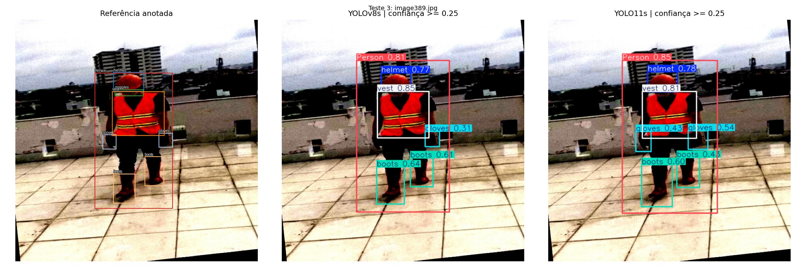
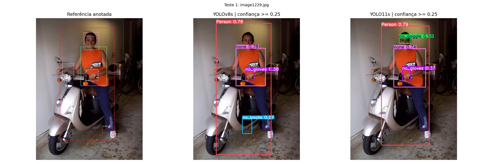
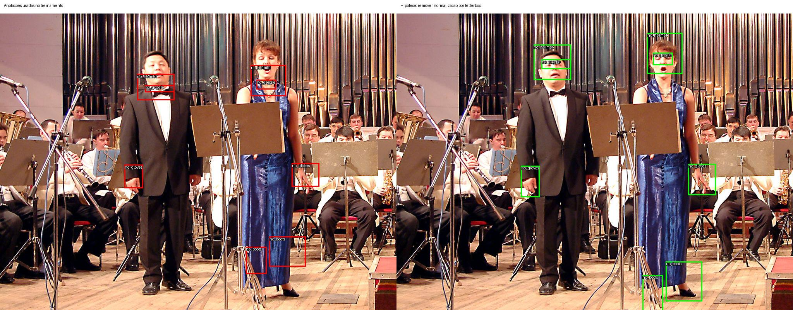

# Detecção de EPIs: comparação de quatro modelos YOLO

Trabalho de detecção de equipamentos de proteção individual (EPIs) com a base
**Construction-PPE**, usando Python, Ultralytics e Google Colab. Foram treinados
**YOLOv8n, YOLO11n, YOLOv8s e YOLO11s**, em duas etapas.

**Resultado principal:** o YOLO11s obteve o maior macro-F1 (**56,46%**) e mAP50-95
(**28,89%**). Houve melhora moderada, mas as classes de ausência de EPI permaneceram
fracas. A investigação posterior encontrou limitações de dados e indícios de
problemas geométricos nas anotações, descritos abaixo.

## O que foi pedido pelo professor

O enunciado solicitou usar o [guia Python da Ultralytics](https://docs.ultralytics.com/pt/quickstart/),
implementar e treinar YOLO com uma base de livre escolha, apresentar resultados
com boxes, comparar duas versões e entregar por link de Colab ou GitHub.

| Pedido | Como foi atendido | Evidência |
|---|---|---|
| Implementar YOLO e treinar uma base escolhida | Fine-tuning com a API Ultralytics e a base Construction-PPE | [Código e resultados nano](yolo_epi.ipynb) e [small](experimento.ipynb) |
| Apresentar resultados com boxes | Previsões com classe e confiança nas 141 imagens de teste de cada modelo | [Exemplos abaixo](#imagens-com-boxes) e [índice dos arquivos](#arquivos-da-entrega) |
| Comparar duas versões | YOLOv8 versus YOLO11, primeiro na variante nano e depois na small | [Comparação geral](#resultados-no-teste) e [F1 por classe](#f1-por-classe) |
| Entregar por link de Colab ou GitHub | Este repositório público, com código, métricas, gráficos, pesos e imagens | [GitHub](https://github.com/ygorbrandaoo/yolo-epi) |

Os resultados podem ser lidos diretamente aqui e nos notebooks, sem repetir os
treinamentos. As seções iniciais dos notebooks foram montadas a partir dos arquivos
reais exportados pelo Colab; os logs das células não foram preservados, mas os
históricos de cada época estão disponíveis.

## Base e protocolo

A base tem **1.132 imagens de treino, 143 de validação e 141 de teste**, com 11
classes. As divisões e as anotações originais foram preservadas. A auditoria
inicial não encontrou duplicatas exatas por SHA-256, mas não elimina cenas parecidas.

| Etapa | Modelos | Épocas por modelo | Parada antecipada |
|---|---|---:|---|
| Referência | YOLOv8n e YOLO11n | 30 | Desativada |
| Tentativa de melhoria | YOLOv8s e YOLO11s | Limite de 50; ambos completaram 50 | Paciência de 10 épocas na validação |

Todos partiram de pesos pré-treinados em COCO. Foram usados resolução 640, batch 16,
seed 42, AdamW e taxa inicial de aprendizado de 0,001, em uma GPU Tesla T4.
O checkpoint `best.pt` foi escolhido pela validação; o teste foi usado para avaliação.
Na segunda etapa, os melhores mAP50-95 de validação ocorreram nas épocas 42 e 48;
a paciência de dez épocas não foi atingida antes do limite de 50.

As condições são iguais entre as duas versões dentro de cada etapa. Entre etapas,
mudamos **tamanho e número de épocas simultaneamente**, portanto não isolamos o
benefício de cada alteração. Foi feita uma execução por configuração, sem várias
seeds ou estimativa de significância estatística. A segunda etapa é exploratória:
os resultados da primeira avaliação já eram conhecidos.

## Resultados no teste

| Modelo | Épocas | Precisão | Recall | Macro-F1 | mAP50 | mAP50-95 |
|---|---:|---:|---:|---:|---:|---:|
| YOLOv8n | 30 | 62,19% | 51,42% | 52,06% | 54,46% | 27,66% |
| YOLO11n | 30 | 54,58% | 51,57% | 52,20% | 54,25% | 27,41% |
| YOLOv8s | 50 | 66,72% | 51,90% | 53,53% | 53,29% | 27,08% |
| **YOLO11s** | **50** | **62,57%** | **53,44%** | **56,46%** | **55,85%** | **28,89%** |

O macro-F1 é a média do F1 das 11 classes, com o mesmo peso para cada uma.
O mAP50-95 exige localização mais precisa das caixas que o mAP50.
Precisão, recall e F1 seguem o ponto de máximo F1 das curvas calculadas pela
Ultralytics no teste; não são necessariamente os valores do limiar visual de 0,25.

O YOLO11s ganhou **4,26 pontos percentuais de macro-F1** sobre o YOLO11n.
O aumento de porte não melhorou todas as métricas: o mAP50-95 do YOLOv8s caiu
ligeiramente em relação ao YOLOv8n. Assim, os experimentos não sustentam que
um modelo maior sempre seja melhor.

Os quatro treinamentos somaram aproximadamente **60 minutos**, além da preparação
e avaliação. Tempos, parâmetros e tamanhos dos pesos estão no
[CSV geral](resultados/comparacao_geral.csv). A inferência foi medida com batch 1 e
FP32, sem pré e pós-processamento; os tempos são indicativos, sem benchmark repetido.

## F1 por classe

| Classe | YOLOv8n | YOLO11n | YOLOv8s | YOLO11s |
|---|---:|---:|---:|---:|
| Capacete | 88,01% | 88,91% | 93,04% | 92,00% |
| Luvas | 76,46% | 76,01% | 80,31% | 81,32% |
| Colete | 82,98% | 84,21% | 86,66% | 85,04% |
| Botas | 67,24% | 70,31% | 70,75% | 70,45% |
| Óculos de proteção | 76,72% | 72,81% | 81,45% | 82,52% |
| Pessoa | 80,86% | 80,65% | 80,74% | 84,31% |
| `none` | 49,71% | 55,67% | 44,68% | 43,55% |
| Sem capacete | 19,46% | 29,21% | 14,34% | 27,46% |
| Sem óculos | 20,06% | 15,64% | 18,64% | 28,91% |
| Sem luvas | 11,15% | 0,75% | 18,23% | 25,48% |
| Sem botas | 0,00% | 0,00% | 0,00% | 0,00% |

Fonte: [F1 por classe em CSV](resultados/f1_por_classe.csv), calculado por
`F1 = 2 × precisão × recall / (precisão + recall)`; zero quando ambos são zero.
Os dados de precisão, recall e AP por classe estão nos arquivos de cada etapa.

## Imagens com boxes

Os exemplos mostram **referência original, YOLOv8s e YOLO11s**, nessa ordem.
Confiança mínima de 0,25 e IoU de NMS de 0,70. As seis imagens foram escolhidas
por seed antes do treinamento e são as mesmas nas duas etapas.



Os equipamentos presentes tiveram resultados melhores. Nos exemplos de ausência,
ainda aparecem omissões e diferenças entre os modelos e a referência anotada:



Há **564 imagens com previsões**, sendo 141 por modelo, além de seis comparações
lado a lado por etapa. As caixas de referência também precisam ser consideradas
à luz das limitações de anotação investigadas a seguir.

## Desafios e limitações

**Poucos exemplos e desbalanceamento.** “Sem botas” tem 88 boxes em apenas **28
imagens de treino**, quatro boxes em duas imagens de validação e 23 boxes em seis
imagens de teste. Botas presentes têm 1.235 boxes no treino. Há pouca diversidade
para aprender a classe rara, e sua avaliação depende de poucas imagens.

**Indícios de desalinhamento das anotações.** Após os treinos, baixamos a base
original e conferimos suas contagens contra os manifestos usados. Nos exemplos
inspecionados, algumas caixas ficam abaixo dos olhos ou acima dos pés. Uma hipótese
é a conversão incorreta de coordenadas entre imagens quadradas com margens
(letterbox) e as imagens retangulares originais. Inverter essa transformação
melhorou visualmente os exemplos examinados, mas **não valida uma correção global**.



A figura é um diagnóstico exploratório, não uma nova previsão do modelo.
As anotações originais não foram alteradas, e não treinamos sobre a hipótese de
correção. Portanto, as métricas publicadas medem o desempenho contra essa referência,
que pode conter erros, e não isolam a capacidade real dos detectores.
A auditoria inicial verificava formato e duplicatas; a revisão visual aprofundada
veio depois. Veja o [levantamento de dados](diagnostico/diagnostico_dados.json).

**Contextos diferentes.** A base inclui cenas fora de obras, como apresentações
musicais e fotos casuais. As classes de ausência aparecem predominantemente em
imagens retangulares, enquanto as de equipamentos presentes aparecem sobretudo
em imagens quadradas. Isso sugere diferenças entre as fontes de dados, cujo
impacto não foi isolado por um experimento controlado.

**Prazo e alcance.** O trabalho foi desenvolvido em uma janela de aproximadamente
**12 horas**, incluindo preparação, execução, análise e organização. Conseguimos
comparar quatro configurações e investigar os erros. Não houve tempo para revisar
as anotações de toda a base, enriquecer as classes raras, calibrar limiares em dados
independentes ou repetir os treinos com várias seeds.

A conclusão é uma **melhora moderada, com limitações importantes nas classes de
ausência de EPI**. O próximo passo prioritário seria validar as anotações e corrigir
os casos confirmados antes de investir em mais capacidade ou épocas. A ausência
de uma detecção de equipamento, isoladamente, não comprova sua ausência.

## Arquivos da entrega

| Evidência | Nano, 30 épocas | Small, 50 épocas |
|---|---|---|
| Notebook com código e resultados salvos | [yolo_epi.ipynb](yolo_epi.ipynb) | [experimento.ipynb](experimento.ipynb) |
| Métricas por modelo e por classe | [Pasta de resultados](resultados/) | [Pasta de resultados](resultados/small/) |
| Históricos, parâmetros e curvas de treino | [Treinos nano](resultados/treinos/) | [Treinos small](resultados/small/treinos/) |
| Matrizes de confusão e curvas de teste | [Teste nano](resultados/teste/) | [Teste small](resultados/small/teste/) |
| Todas as imagens com previsões | [YOLOv8n](resultados/previsoes/yolov8n/) · [YOLO11n](resultados/previsoes/yolo11n/) | [YOLOv8s](resultados/small/previsoes/yolov8s/) · [YOLO11s](resultados/small/previsoes/yolo11s/) |
| Seis comparações com referência | [Visuais nano](resultados/visuais/) | [Visuais small](resultados/small/visuais/) |

Os quatro melhores checkpoints estão em [pesos/](pesos/). Os arquivos originais
exportados pelo Colab foram preservados localmente; seus hashes estão nos arquivos
[de origem nano](resultados/origem.json) e [small](resultados/small/origem.json).
Os ZIPs e checkpoints intermediários não são versionados. Os manifestos exportados
conservam os caminhos da sessão original; o notebook recria os caminhos ao executar.

## Reproduzir e verificar

Abra [nano no Colab](https://colab.research.google.com/github/ygorbrandaoo/yolo-epi/blob/main/yolo_epi.ipynb)
ou [small no Colab](https://colab.research.google.com/github/ygorbrandaoo/yolo-epi/blob/main/experimento.ipynb),
selecione **GPU T4** e use **Executar tudo**. O dataset e os pesos iniciais são
baixados automaticamente. O bloco **Parâmetros editáveis** controla tamanho,
épocas, paciência, resolução, batch, seed, taxa de aprendizado e confiança visual.
Cada execução recebe uma pasta e um ZIP próprios.

O gerador `montar.py` reúne as células, incorpora os resultados salvos e produz os
dois notebooks e os CSVs consolidados. `auditoria.py` valida boxes, identifica
duplicatas e calcula F1 por classe. Para gerar os artefatos e executar os testes:

```bash
python3 montar.py
python3 -m unittest -v
```

Os **20 testes** cobrem configurações, parada antecipada, relatórios, F1, anotações,
duplicatas e correspondência dos resultados importados. Também foi executada análise
estática com Ruff, regras F. Esses testes não repetem o treinamento nem comprovam
a correção semântica das anotações. Não há pipeline de CI configurado.

## Referências e atribuição

- [Construction-PPE e licença AGPL-3.0](https://docs.ultralytics.com/datasets/detect/construction-ppe/)
- [Formato das anotações YOLO](https://docs.ultralytics.com/datasets/detect/)
- [YOLOv8](https://docs.ultralytics.com/models/yolov8/) e [YOLO11](https://docs.ultralytics.com/models/yolo11/)
- [Treinamento](https://docs.ultralytics.com/modes/train/), [validação](https://docs.ultralytics.com/modes/val/) e [predição](https://docs.ultralytics.com/modes/predict/)

Base: Mrunmayee Dalvi, Niyati Singh, Sahil Bhingarde e Ketaki Chalke.
*Construction-PPE: Personal Protective Equipment Detection Dataset*, versão 1.0.0,
2025, Ultralytics. A base e a biblioteca são distribuídas sob AGPL-3.0; o uso das
imagens e dos modelos derivados deve respeitar os termos aplicáveis.
