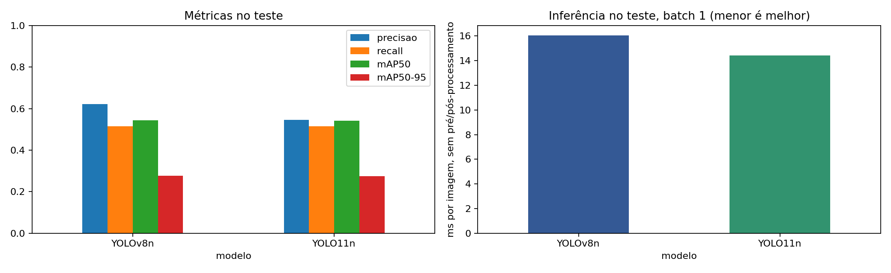
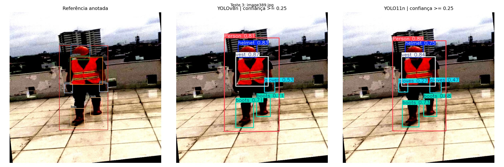
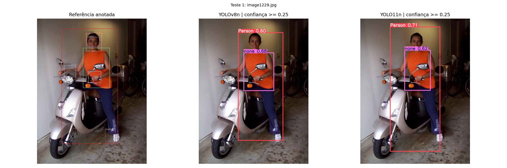

# Detecção de EPIs com YOLOv8 e YOLO11

Comparação de **YOLOv8n e YOLO11n** na base Construction-PPE, com treinamento,
avaliação no teste e imagens com bounding boxes. Atividade realizada com a API
Python da Ultralytics e Google Colab.

## Entrega da atividade

**Formato escolhido: link do repositório no GitHub.** O código, os resultados dos
treinamentos e as imagens com boxes estão reunidos aqui para avaliação.
O Colab foi usado para executar o experimento e também pode ser usado para reproduzi-lo.

| O que foi pedido pelo professor | Como foi atendido | Onde conferir |
|---|---|---|
| Implementar o YOLO seguindo o guia fornecido | Uso da API Python da Ultralytics, com carregamento de pesos, treinamento, avaliação e predição | [Notebook com código e resultados](yolo_epi.ipynb) |
| Treinar com uma base de dados de livre escolha | Base Construction-PPE, dedicada a EPIs e pessoas; 30 épocas de fine-tuning para cada modelo | [Base e protocolo](#base-e-protocolo), [histórico do YOLOv8n](resultados/treinos/yolov8n/results.csv) e [histórico do YOLO11n](resultados/treinos/yolo11n/results.csv) |
| Enviar resultados com marcações de boxes | 141 imagens de teste anotadas por modelo, com classe e confiança; seis comparações entre referência e previsões | [Exemplos visíveis abaixo](#imagens-com-boxes), [todas as previsões do YOLOv8n](resultados/previsoes/yolov8n/) e [do YOLO11n](resultados/previsoes/yolo11n/) |
| Comparar duas versões do YOLO | YOLOv8n e YOLO11n treinados nos mesmos dados e condições, comparando precisão, recall, mAP e tempo de inferência | [Tabela de comparação](#resultados-no-teste), [CSV](resultados/comparacao.csv) e [conclusão](resultados/conclusao.md) |
| Entregar por link de Colab ou GitHub | Entrega pelo GitHub, com evidências consultáveis no README, no notebook e nas pastas de resultados | Este repositório |

Os resultados podem ser avaliados diretamente nesta página e no notebook,
sem repetir os treinamentos. A implementação usa modelos pré-treinados e faz
fine-tuning na base escolhida, conforme o fluxo da biblioteca indicada no enunciado.

O [notebook](yolo_epi.ipynb) inclui os resultados salvos e as células para reproduzir
o experimento. As métricas e imagens iniciais foram importadas da execução real
no Colab em **30/10/2026**. Podem ser consultadas sem repetir o treinamento.
Os logs de execução das células do Colab não foram preservados no notebook local;
os históricos por época estão em `resultados/treinos/`.

## Resultados no teste

| Métrica | YOLOv8n | YOLO11n |
|---|---:|---:|
| Precisão | 62,19% | 54,58% |
| Recall | 51,42% | 51,57% |
| mAP50 | 54,46% | 54,25% |
| mAP50-95 | 27,66% | 27,41% |
| Inferência por imagem | 16,05 ms | 14,41 ms |
| Tempo de treinamento | 9,63 min | 10,09 min |
| Parâmetros | 3,01 milhões | 2,58 milhões |

Fonte: [tabela completa em CSV](resultados/comparacao.csv). Inferência medida pelo
validador na Tesla T4, batch 1 e FP32, sem pré e pós-processamento. Os tempos de
inferência são indicativos de uma execução, sem repetições de benchmark.
Precisão e recall são os resumos da Ultralytics no ponto de máximo F1 de suas curvas;
não correspondem necessariamente ao limiar de 0,25 usado nas figuras.



O YOLOv8n obteve uma pequena vantagem de **0,25 ponto percentual no mAP50-95**.
O YOLO11n teve menor tempo de inferência e menos parâmetros. Os resultados são
próximos e uma execução por modelo não permite estabelecer superioridade geral.

Os modelos tiveram melhores resultados em equipamentos como capacetes e coletes,
mas dificuldade nas classes de ausência de EPI. No YOLOv8n, por exemplo, o AP50-95
foi 51,87% para capacetes e 58,23% para coletes, contra 5,62% para `no_helmet`
e 0,54% para `no_boots`.

- [Resultados por classe](resultados/comparacao_por_classe.csv)
- [Conclusão da execução](resultados/conclusao.md)
- [Matriz de confusão do YOLOv8n](resultados/teste/yolov8n/confusion_matrix_normalized.png)
- [Matriz de confusão do YOLO11n](resultados/teste/yolo11n/confusion_matrix_normalized.png)

## Imagens com boxes

Cada exemplo mostra **referência anotada, YOLOv8n e YOLO11n**, nessa ordem.
Os dois modelos usam confiança mínima de 0,25 e IoU de NMS de 0,70.
As seis imagens foram escolhidas por seed antes do treinamento.

Neste exemplo, ambos detectam pessoa, capacete, colete e botas. O YOLOv8n deixa
uma das luvas sem detecção, enquanto o YOLO11n a detecta com confiança de 0,27.



Este exemplo evidencia as limitações: os modelos detectam a pessoa e a classe
`none`, mas deixam de detectar as classes de ausência de EPI anotadas na referência.
A base inclui cenas variadas, inclusive fora de canteiros de obras.



Há [seis comparações lado a lado](resultados/visuais/) e previsões salvas para
**todas as 141 imagens de teste de cada modelo**:

- [Previsões do YOLOv8n](resultados/previsoes/yolov8n/)
- [Previsões do YOLO11n](resultados/previsoes/yolo11n/)

## Base e protocolo

A [Construction-PPE](https://docs.ultralytics.com/datasets/detect/construction-ppe/)
contém 11 classes, preservadas com os nomes originais:
`helmet`, `gloves`, `vest`, `boots`, `goggles`, `none`, `Person`,
`no_helmet`, `no_goggle`, `no_gloves` e `no_boots`.

| Divisão | Imagens | Boxes |
|---|---:|---:|
| Treino | 1.132 | 9.098 |
| Validação | 143 | 1.172 |
| Teste | 141 | 1.251 |

A [auditoria](resultados/auditoria.json) não encontrou duplicatas exatas por SHA-256.
Isso não exclui imagens visualmente parecidas ou cenas compartilhadas entre divisões.
Não houve agrupamento por obra ou câmera.

- Modelos pré-treinados em COCO: `yolov8n.pt` e `yolo11n.pt`.
- Mesmos manifestos e configuração para ambos: 30 épocas, imagens de 640 pixels,
  batch 16, seed 42 e otimizador AdamW, com taxa inicial de aprendizado de 0,001.
- Sem parada antecipada. O checkpoint `best.pt` é escolhido na validação.
- Teste reservado para a avaliação final dos checkpoints escolhidos.
- Ultralytics 8.3.221, PyTorch 2.11.0+cu130 e GPU Tesla T4.
- Uma execução por modelo, sem estimativa de variância entre seeds.

Veja a [configuração completa](resultados/configuracao.json), a
[distribuição de classes](resultados/distribuicao.csv) e as
[versões do ambiente](resultados/dependencias.txt).
O conjunto de treino é desbalanceado: `no_boots`, por exemplo, tem 88 boxes,
enquanto `Person` tem 1.770. A análise deve considerar esse contexto.
A ausência de uma detecção de equipamento, isoladamente, não comprova sua ausência.

## Reproduzir no Colab

[](https://colab.research.google.com/github/ygorbrandaoo/yolo-epi/blob/main/yolo_epi.ipynb)

1. Abra o notebook pelo botão **Abrir no Colab**.
2. Selecione **Ambiente de execução > Alterar tipo de ambiente de execução > GPU T4**.
3. Use **Executar tudo**. O notebook baixa automaticamente a base e os pesos iniciais.
4. Aguarde os dois treinamentos, a avaliação e a exportação de `entrega.zip`.

A execução original levou cerca de 20 minutos para os dois treinamentos, além
da preparação e avaliação. O tempo varia conforme o ambiente disponível.
Uma nova execução pode produzir números diferentes, mesmo com a mesma seed.

## Organização

```text
yolo_epi.ipynb        Notebook com resultados salvos e código do experimento
montar.py             Gerador do notebook a partir do código e dos resultados
auditoria.py          Validação das anotações e controle de duplicatas
test_projeto.py       Testes locais
requirements.txt      Dependências do experimento
pesos/                Melhores pesos treinados, um arquivo por modelo
resultados/
  comparacao.csv      Métricas gerais no teste
  conclusao.md        Conclusão quantitativa da execução
  visuais/            Seis comparações com boxes lado a lado
  previsoes/          Todas as imagens de teste anotadas pelos dois modelos
  teste/              Curvas, matrizes e previsões usadas na avaliação
  treinos/            Históricos por época, gráficos e parâmetros
```

Os [pesos do YOLOv8n](pesos/yolov8n.pt) e [do YOLO11n](pesos/yolo11n.pt) são os
checkpoints `best.pt` da execução. O arquivo original `entrega.zip` foi preservado
localmente; seu hash está em [origem.json](resultados/origem.json).

Os manifestos e os arquivos de configuração exportados conservam os caminhos da
sessão original do Colab. Para uma nova execução, o notebook recria esses caminhos.

Para usar um dos modelos já treinados em uma imagem local:

```bash
pip install -r requirements.txt
```

```python
from ultralytics import YOLO

modelo = YOLO('pesos/yolov8n.pt')
modelo.predict('foto.jpg', conf=0.25, save=True)
```

## Verificações

```bash
python3 montar.py
python3 -m unittest -v
```

Os 11 testes cobrem anotações inválidas, duplicatas, índices das métricas por classe,
sintaxe das células e correspondência entre as imagens e métricas salvas e o notebook.
Esses testes não repetem o treinamento.
A análise estática do Ruff para erros Python (regras F) também foi executada.

## Referências e atribuição

- [Guia indicado pelo professor](https://docs.ultralytics.com/pt/quickstart/)
- [Construction-PPE, autores e licença AGPL-3.0](https://docs.ultralytics.com/datasets/detect/construction-ppe/)
- [YOLOv8](https://docs.ultralytics.com/models/yolov8/) e [YOLO11](https://docs.ultralytics.com/models/yolo11/)
- [Treinamento](https://docs.ultralytics.com/modes/train/), [validação](https://docs.ultralytics.com/modes/val/) e [predição](https://docs.ultralytics.com/modes/predict/)
- [Configuração da base na versão fixada](https://github.com/ultralytics/ultralytics/blob/v8.3.221/ultralytics/cfg/datasets/construction-ppe.yaml)

Base: Mrunmayee Dalvi, Niyati Singh, Sahil Bhingarde e Ketaki Chalke.
*Construction-PPE: Personal Protective Equipment Detection Dataset*, versão 1.0.0,
2025, Ultralytics. A base e a biblioteca Ultralytics são distribuídas sob AGPL-3.0;
as imagens e os modelos derivados devem respeitar os termos aplicáveis.
Este trabalho apresenta um experimento acadêmico limitado à base e às suas anotações.
